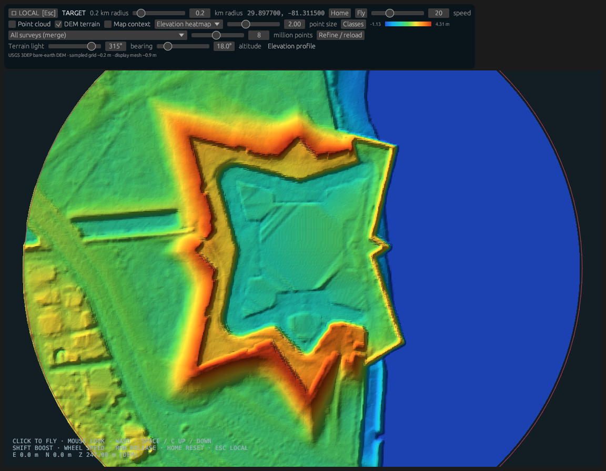
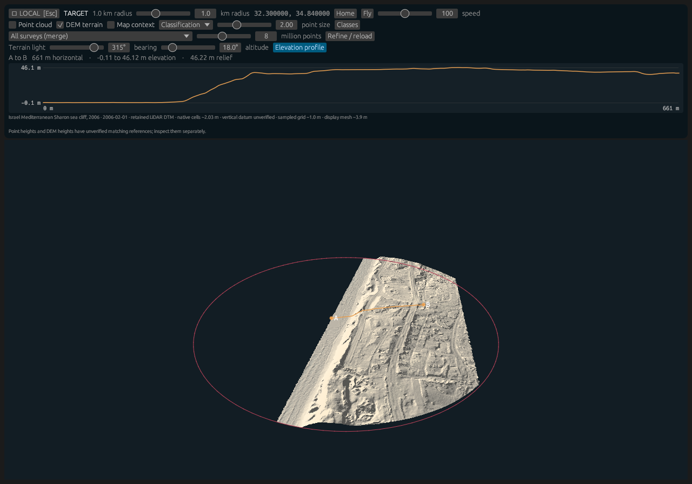

# Target inspection

In **Local → Earth**, click **TARGET**. Move the pointer to position the red
selection cylinder. **km radius** adjusts its WGS84 ground radius from **0.1 to
100 km**, starting at 1 km. The mouse wheel can zoom the Local map while placing
the circle. Left click opens an independent 3D cut-out; **Escape** returns to the
previous Local camera, including its position, zoom and viewing angles. Escape
also cancels the selection tool before entry.

Inside Target, change **km radius** and click **Apply radius** to reload the
cut-out around the same center. The merge/single-survey choice, point budget
and display options are retained. Framing and initial flight speed scale to the new size.
The last chosen radius is retained when returning to Local during this session.
Teal published survey outlines also appear while selecting, even if the normal
LiDAR raster layer is off.

Click the Target canvas or **Fly** to capture the mouse. Move the mouse to look,
use **WASD** to fly, **Space / C** to move vertically, and **Shift** to boost.
The mouse wheel changes speed. **Right click** releases the pointer for the
controls; **Home** resets the Target camera. Flight can pass through surfaces
and go outside the fixed cut-out. It never requests a new geographic region as
the camera moves. The boundary stays at the selected radius from its center.

## Inspecting measured terrain

Choose **Elevation heatmap** from the Target color menu to color low elevations
blue, middle elevations green and high elevations yellow through red. For the
bare-earth view, enable **DEM terrain** and turn off **Point cloud**. The terrain
light brings out slopes within each color band.

The legend shows the elevation range of the enabled layers inside the Target
circle. It updates as points load or you filter **Classes**, and stays fixed as
you fly. DEM elevations are in metres. Point elevations use the survey's source
units unless its NAVD88 metre reference is verified.

With **DEM terrain** enabled, use **Bearing** and **Altitude** to move the low-angle
light across the surface. Choose **Elevation profile**, then click two points
on the terrain or drag from A to B. The chart shows horizontal distance,
minimum and maximum elevation, and relief in metres. Hover over the chart to
read distance and height at a sample. Gaps indicate missing DEM data. Picking
uses the visible triangles and the profile samples the underlying height grid.
Click again to start another section. **Fly** returns to navigation.

## Data and accuracy

- **Point cloud** defaults to **All surveys (merge)**, combining original
  observations from intersecting supported USGS EPT and OpenTopography bulk
  LAS/LAZ sources. The selector also permits single-survey inspection.
  Actual polygons rank the central survey; neighboring footprints that add
  coverage are visited before repeated coverage of the same area. Dates,
  references, publisher links and per-source point counts appear under
  **Survey sources**. Every point batch retains its source identity.
- **DEM terrain** loads numeric bare-earth heights from the existing state,
  national and international elevation adapters. It first checks retained
  ground rasters indexed in `Lidar/bulk.sqlite`, using a locally available
  numeric raster only when metre height units are verified. Its numeric requested grid is
  retained for ground placement; a coarser, explicitly
  labelled display mesh keeps flight responsive. Missing heights stay holes.
- **Map context** includes available cached roads, water and prepared vector
  cells, visible imported vector layers, and nearby event/camera markers.
  Overlays are draped on valid DEM heights. Building footprints remain
  footprints; unprovided building heights are not invented. Context is a
  snapshot of available data at entry, not a new bulk acquisition.
  For radii above 5 km, detailed cached roads/cells are limited to the central
  5 km radius. Imported context is still clipped to the whole Target.

Large targets use bounded regional overviews rather than uniform one-metre
coverage. For example, the 100 km NC check requested a 2048 × 2048 height grid
at approximately 98 m sampling, with a roughly 392 m display mesh. Both spacings
are reported. Wide numeric exports currently use USGS, NCEM and supported
England/Netherlands/France services; other fine-source adapters retain their
small-window limits to prevent a large COG/tile download fanout. Point-cloud
detail remains controlled by its separate point and transfer budgets. A
100 km radius covers 10,000 times the area of a one-kilometre radius.

Projected LAS batches share an offline PROJ transform on their loading thread.
Systems without the native transform use the configured GDAL executable.

Source XYZ is decoded as float64. WGS84 selection and local metre offsets are
calculated before conversion to GPU float32; the local-coordinate regression
requires less than 0.1 mm of display-coordinate conversion error on its fixture.
This checks software precision, not survey measurement accuracy. Source
classification, intensity, return number and available RGB are retained in the
display attributes. Noise classes 7/18 and withheld returns are excluded. Point
size changes only the display footprint, not measured positions.
Horizontal coordinates use a WGS84 geodesic distance chart around the center;
original source XYZ remains authoritative.

Some EPT feeds declare no vertical coordinate system or Z units. Target keeps
original numeric Z and shows these surveys together with an **Unverified
heights** label. No coordinate values are averaged, rescaled or shifted to
smooth acquisition seams. Original observations from different dates can
overlap; the selector allows each source to be inspected separately.
Conflicting explicitly declared height references are reported and excluded
from the merged view; those sources can still be inspected individually.
Target permits combined DEM/point display only when **every** contributing
survey has a matching NAVD88 metre reference;
otherwise the two are inspected separately. No vertical offsets, datum
conversion or automatic alignment are inferred from similar-looking heights.
DEM-draped context follows the same rule. There is no synthetic filling of
point-cloud gaps or conversion of grid cells into fake laser returns.

## Loading and resource limits

Nodes load progressively, keeping already displayed points visible as neighbors
load. The default budget is eight million points; the control supports one to
sixteen million and **Refine / reload** requests the chosen budget. Half the
combined point budget is initially shared across candidate surveys so a dense
first source cannot consume it all. Unfinished readers then resume to add
detail. Source-record cursors avoid replaying earlier observations; this is
not spatial rounding or coordinate averaging.

All sources and passes share a 96-million decoded-record budget, 4096 node/file
reads, 256 MiB network-transfer budget and 180-second loading window. Discovery
selects up to 64 supported candidates from a bounded catalog query, prioritizing
complementary footprints. A candidate, point, transfer, time or hierarchy limit
is reported as partial detail. Source failures retain successful batches and
allow other surveys to continue. A wholly unsuccessful reload preserves the
previous display. Full source density can exceed these budgets even in a
one-kilometre circle. No claim of continuous coverage is inferred from survey
footprints, sparse returns or a completed source read.

Existing EPT blocks are reused through the bounded LiDAR download cache. This
does not delete raw scans or turn raster receipts into point-cloud archives.
Published cloud coverage and locally indexed catalogs determine availability;
the viewer does not yet decode every provider's local LAS/COPC holding. A teal
survey boundary remains a published footprint, including surveys that need
another point reader. Finished empty loads report that state explicitly;
the source selector does not keep claiming to search after a worker finishes.

OpenTopography bulk access currently supports linked single-file LAS/LAZ
collections up to 32 MiB within the existing 256 MiB transfer / 1 GiB source
cache limits. Larger or multi-file collections require a spatial LAS/COPC
index and are reported as unsupported. LAS is decoded in Rust; configured
GDAL tools transform batches of horizontal coordinates only, with network grid
fetching disabled. Source Z and point attributes stay unchanged. Scanning a
bulk file can take longer than loading indexed EPT nodes.

The Sharon coastal survey in Israel now loads its original 2006 points and its
retained ground DEM. The local DEM's actual native cells are approximately
2.03 m; an approximately 1 m requested grid does not create extra source detail.
Its uncertain vertical reference remains separate from the point display.
Only numeric rasters with declared metre band units or explicitly verified
publisher units are accepted. Independent retained raster tiles/acquisitions
are not silently blended to fill missing data.
Escape cancels jobs, releases the cursor, and frees Target GPU buffers on the
next Local frame. Loading animation preferences do not affect flight controls.

The native desktop is rebuilt from `one-thousand-electric-eye-desktop`. Opt-in
live checks use `ONEKEE_TARGET_TEST_CATALOG` and disposable output under `/tmp`;
they do not replace the user's terrain or fused raster archives.

See the [Kinston benchmark and real-data previews](benchmarks/target-nc-2026-11-16.md).
The [100 km validation](benchmarks/target-radius-2026-11-16.md) records the
regional overview and Local catalog-outline checks.
See also the [Israel and Manhattan source validation](benchmarks/target-sources-2026-11-17.md).
The [merged Hudson validation](benchmarks/target-merge-2026-11-17.md) checks
combined neighboring point clouds and measured coverage beyond the first source.
